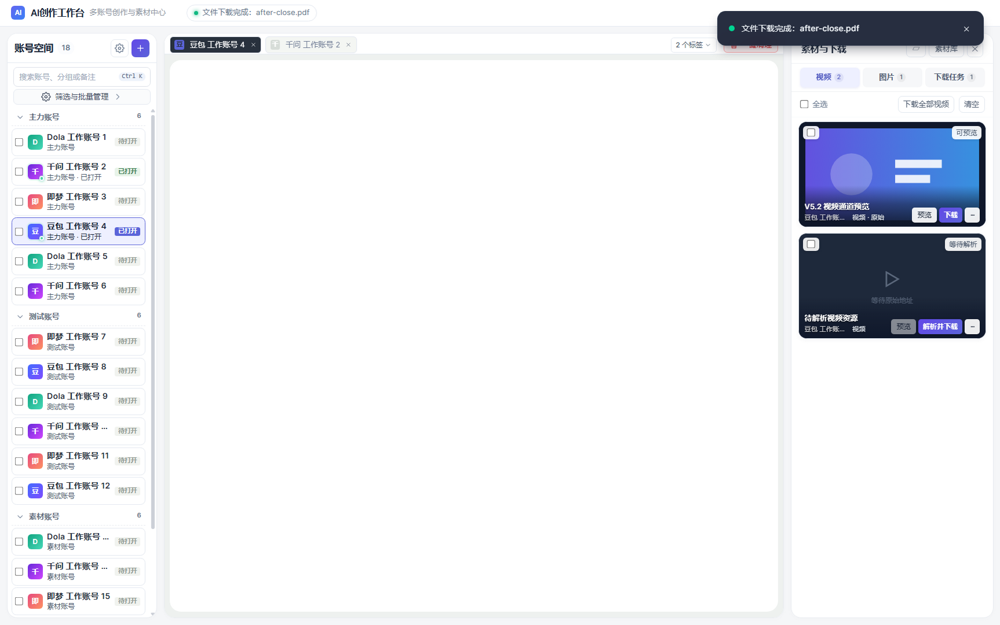
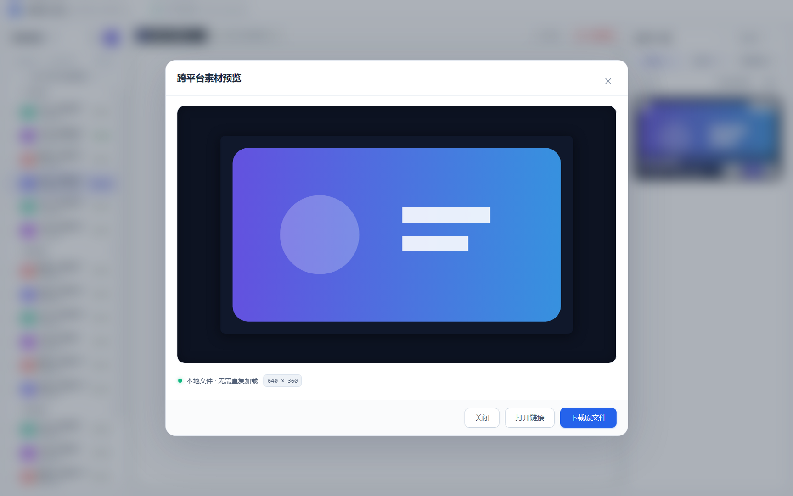
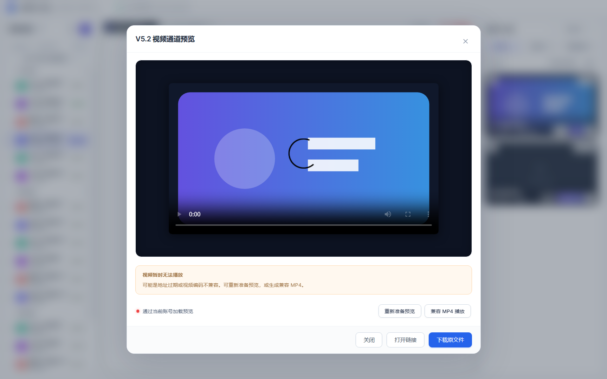
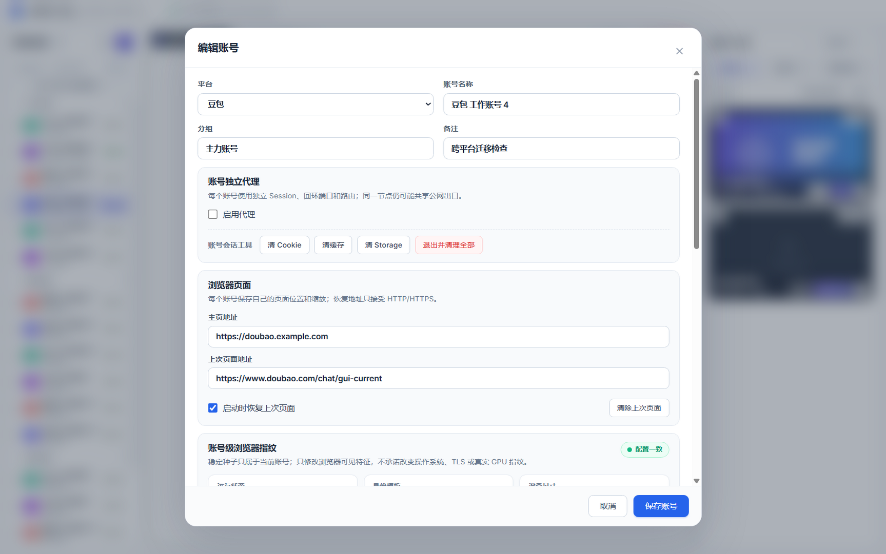
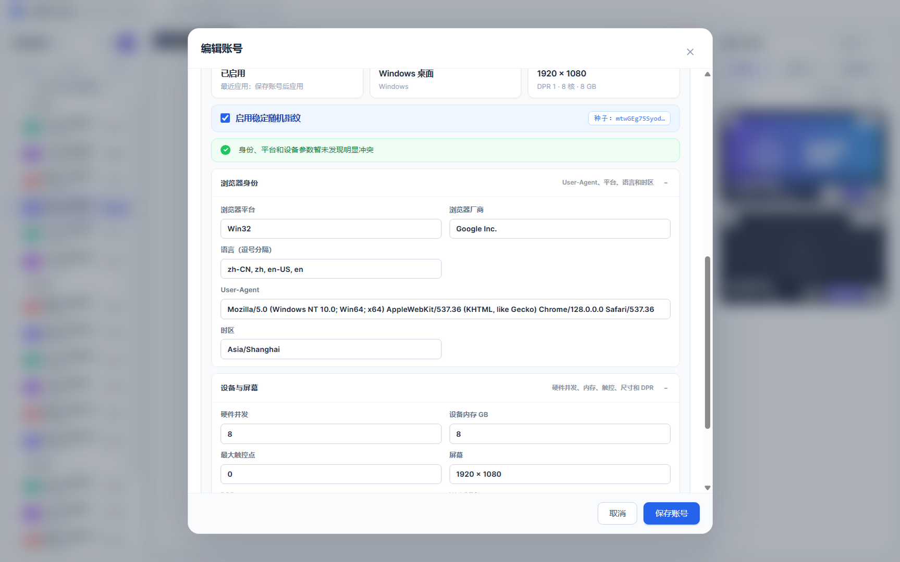
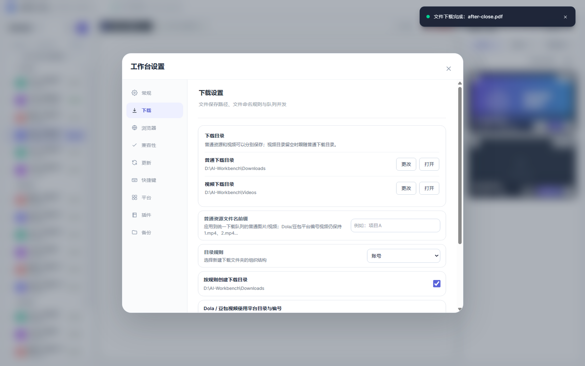
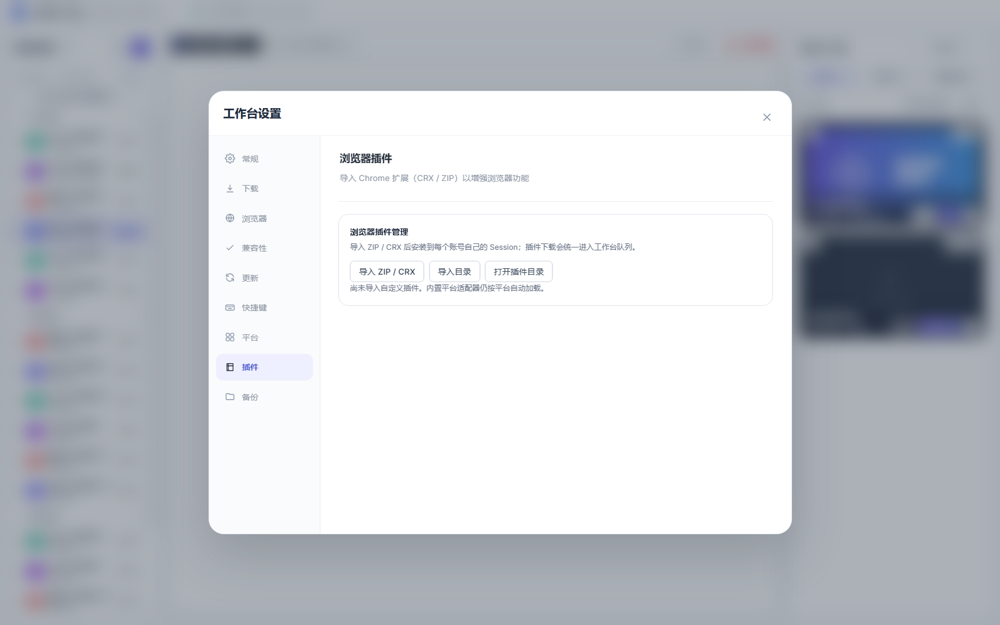

# AI 创作工作台

跨平台的多账号 AI 创作工作台：把多个第三方 AI 站点的账号、浏览器会话、代理、指纹和素材下载集中到一个桌面应用里管理。

[](https://github.com/selectarget/AIworkbench/actions/workflows/release.yml)

- Windows x64：单文件便携版（portable `.exe`）
- macOS Intel（x64）与 Apple Silicon（arm64）：独立 DMG
- 不需要安装 .NET / Node.js，Electron 自带 Chromium 与 Node 运行时

## 功能

| 模块 | 说明 |
| --- | --- |
| 多账号隔离 | 每个账号使用独立的 `persist:account_<id>` Electron 会话，Cookie、LocalStorage、IndexedDB、缓存互不干扰；支持分组、批量创建、排序和批量改代理 |
| 内置浏览器 | `WebContentsView` 承载站点页面，支持多标签、双栏视图、缩放、静音休眠、Boss Key 隐藏/唤起 |
| 素材捕获 | 从页面网络响应、DOM、`srcset`、CSS 背景、`blob:` 地址中识别图片和视频，按账号作用域过滤，可切换仅图片/仅视频/全部 |
| 下载队列 | 并发数、重试次数、断点续传、限速冷却、候选地址回退、账号独立目录、文件名模板、旧版目录兼容 |
| 视频预览 | 打包 FFmpeg 将无法直接预览的格式转码为本地缓存预览，原片保持不变 |
| 代理 | 内置 sing-box 运行时；支持直连代理和订阅导入（VMess/VLESS/Trojan/Shadowsocks/Hysteria2 等），节点测速、延迟/出口 IP 检测、按账号绑定 |
| 浏览器指纹 | UA、UA-CH、WebGL、Canvas/Audio 噪声、时区、屏幕参数、WebRTC 策略；按账号持久化并可在 Windows/macOS 间适配 |
| 平台自动化 | 豆包历史会话一键清理、Dola 批量登录/参考图上传/视频提交、即梦原始视频、Higgsfield 批量流程 |
| 工具 | 人脸网格裁剪（OpenCV DNN）、旧版配置迁移、Session 导入、插件（CRX2/CRX3）、诊断导出、日志查看 |
| 更新 | 从 GitHub Releases 检查新版本；下载更新需要签名清单与公钥 |

### 支持的平台

豆包、千问、Dola、云雀、Higgsfield、Kimi、oiioii、nano、Lovart、即梦，以及任意自定义 HTTP(S) 网站。

带专用适配器的平台：豆包、千问、Dola、云雀、Higgsfield、即梦；其余平台使用通用浏览器容器和通用媒体捕获。

## 截图

截图来自本机 Windows 构建，macOS 使用相同的界面布局。

| | |
|:---:|:---:|
| <br>账号空间、标签页与右侧素材队列 | <br>素材大图预览与下载入口 |
| <br>视频预览与原始地址解析 | <br>账号独立 Session、代理与浏览器页面 |
| <br>账号级稳定指纹与平台参数适配 | <br>下载目录、命名规则与分平台归档 |
| <br>Chrome 扩展（CRX/ZIP）导入 | |

## 技术栈

- Electron 43 + React 19 + TypeScript 5.9
- electron-vite 5 / Vite 7 / Tailwind CSS 4
- Zod 4（主进程 IPC 参数与持久化数据校验）
- sing-box 1.13.19（代理核心，随包提供三平台二进制）
- FFmpeg 静态构建（视频兼容预览）
- OpenCV.js WASM（人脸检测）
- Vitest（单元/集成测试）

## 架构

```
app/
├─ src/main/       Electron 主进程：账号、浏览器、代理、媒体、下载、插件、更新
├─ src/preload/    沙箱 preload，通过 contextBridge 暴露受控 API
├─ src/renderer/   React 界面
├─ src/shared/     Zod schema、IPC 通道名、平台定义、URL 规范化
├─ scripts/        构建、资源校验、冒烟测试、发布辅助脚本
├─ tests/          Vitest 测试
├─ sing-box/       三平台代理核心 + 哈希清单
├─ media-tools/    三平台 FFmpeg + 许可文件
├─ face-grid-assets/ 人脸检测模型
└─ build-assets/   图标、macOS entitlements
```

关键设计：

- **进程隔离**：渲染进程开启 `contextIsolation`、`sandbox`、关闭 `nodeIntegration`；所有能力经 preload 白名单和 IPC 通道暴露。
- **参数校验**：主进程对每个 IPC 请求做 Zod 校验，并对文件路径、URL 协议、更新来源做白名单限制。
- **数据原子写入**：账号、设置、下载任务使用临时文件 + rename 的原子存储，避免崩溃时写坏 JSON。
- **会话隔离**：账号 ID 决定 Chromium partition，代理、指纹、插件和下载目录都绑定到账号。
- **外部资源固定**：sing-box 和 FFmpeg 通过 `native-resources.json` / 脚本内 SHA-256 校验来源与架构，发布前再由 `audit-package.mjs` 复核。

## 开发

### 环境要求

- Node.js 22 LTS（CI 使用 Node 22）
- npm 10+
- Git LFS（仓库中的 sing-box 与 FFmpeg 二进制使用 LFS 存储）

### 启动

```bash
git lfs install
git clone https://github.com/selectarget/AIworkbench.git
cd AIworkbench/app
npm ci
npm run dev
```

Windows 也可以直接运行仓库根目录的 `启动开发环境.cmd`。

### 常用命令

| 命令 | 作用 |
| --- | --- |
| `npm run dev` | 开发模式（主进程/preload 文件变更自动重启） |
| `npm run typecheck` | TypeScript 全量类型检查 |
| `npm test` | 运行 Vitest 单元/集成测试 |
| `npm run build` | 构建主进程、preload 和渲染进程到 `out/` |
| `npm run smoke:all` | 串联类型检查、单元测试和本地 Electron 冒烟 |
| `npm run smoke:isolation` | 账号会话隔离冒烟 |
| `npm run smoke:gui` | 渲染界面截图/布局冒烟 |
| `npm run smoke:public-sites` | 公开站点入口与适配器注入检查 |
| `npm run audit:legacy-surface` | 旧版 API 表面审计（需要本地保留 `reference-original/`，缺失时跳过） |

### 本地打包

Windows（x64）：

```bash
npm run pack:win   # 目录包 release/win-unpacked
npm run dist:win   # 便携版 release/AI创作工作台-<version>-win-x64-portable.exe
npm run smoke:portable
```

macOS（需在 macOS 主机执行）：

```bash
npm run pack:mac            # x64 + arm64 目录包
npm run dist:mac:unsigned   # 未签名 DMG（CI 同款）
npm run dist:mac            # 签名 + 公证 DMG
```

校验 macOS 产物：

```bash
npm run verify:mac-release -- "release/mac-arm64/AI创作工作台.app" arm64 --dmg "release/AI创作工作台-<version>-mac-arm64.dmg"
```

## 数据目录

| 运行方式 | 数据位置 |
| --- | --- |
| 开发模式 | `app/data-dev/` |
| Windows 便携版 | 程序所在目录旁的 `data/`（目录不可写时退回 `%APPDATA%\AI创作工作台\data`） |
| macOS | `~/Library/Application Support/AI创作工作台/data/` |

子目录：`config/`（账号、设置、插件、备份）、`sessions/`（Chromium 会话）、`logs/`（`workbench.log`、`chromium.log`）、`downloads/`、`updates/`。

代理密码使用 Electron `safeStorage` 加密后保存；应用不保存站点账号密码，第三方登录由各站点页面自行完成。

## CI 与发布

| 工作流 | 触发 | 产物 |
| --- | --- | --- |
| `.github/workflows/release.yml` | 推送 `v*` 标签或手动运行 | Windows portable + macOS x64/arm64 DMG，自动创建 GitHub Release 并附 `SHA256SUMS.txt` |
| `.github/workflows/build-macos.yml` | 推送到 `app/**` 或手动 | macOS x64/arm64 未签名目录包与 DMG，完成审计和启动冒烟（不保留产物） |
| `.github/workflows/release-macos.yml` | 手动 | 签名、公证后的 macOS DMG，需要 Apple 证书与公证密钥 |
| `.github/workflows/build-macos-test-release.yml` | 手动 | 未签名 macOS 测试 DMG，上传到 draft Release |

发布新版本：

```bash
cd app
npm version 1.0.2 --no-git-tag-version   # 或手动修改 package.json
cd ..
git commit -am "chore: release v1.0.2"
git push origin main
git tag v1.0.2
git push origin v1.0.2
```

`release.yml` 会自动把标签版本写入打包配置，因此 Release 中的文件名和应用版本与标签一致。macOS 使用 `macos-15-intel`（x64）和 `macos-15`（arm64）原生 runner。

自动构建的 macOS 包**未签名、未公证**。首次打开请右键选择“打开”，或在“系统设置 → 隐私与安全性”中允许。需要正式签名发布时，配置以下仓库 Secrets 并手动运行 `release-macos.yml`：

`MACOS_CERTIFICATE_P12_BASE64`、`MACOS_CERTIFICATE_PASSWORD`、`APPLE_ID`、`APPLE_APP_SPECIFIC_PASSWORD`、`APPLE_TEAM_ID`。

### 自动更新

应用默认从 `selectarget/AIworkbench` 的 GitHub Releases 检查新版本，可用 `GITHUB_RELEASE_REPO=owner/repo` 覆盖。下载更新包还需要 Release 中存在由 `UPDATE_PRIVATE_KEY` 签名的 `update-manifest-<target>.json`，且构建时注入对应公钥 `UPDATE_PUBLIC_KEY`；当前自动发布流程只负责生成安装包，不生成签名更新清单。

## 已知限制

- 真实站点的登录、验证码、2FA、生成任务和下载权限必须用自有账号人工验收，自动化测试不会冒充这些流程。
- 第三方站点页面结构变化可能导致专用适配器失效；通用浏览器和媒体捕获仍可继续使用。
- 未签名的 macOS 构建会受到 Gatekeeper 拦截；Windows 便携版未做代码签名，可能出现 SmartScreen 提示。
- `reference-original/` 反编译材料不进入仓库，因此旧版 API 表面审计只在保留了该目录的机器上执行。
- 使用本工具时请遵守目标网站的服务条款和当地法律；项目不提供绕过付费、权限或访问控制的能力。

## 第三方组件

- [sing-box](https://github.com/SagerNet/sing-box)：GPL-3.0-or-later，许可文件见 `app/sing-box/licenses/`
- FFmpeg 静态构建：GPL 构建，许可与再分发说明见 `app/media-tools/licenses/`
- OpenCV.js：Apache-2.0，许可文件见 `app/face-grid-assets/licenses/`
- Electron、React、Vite、Tailwind CSS、Zod 等依赖遵循各自许可证
